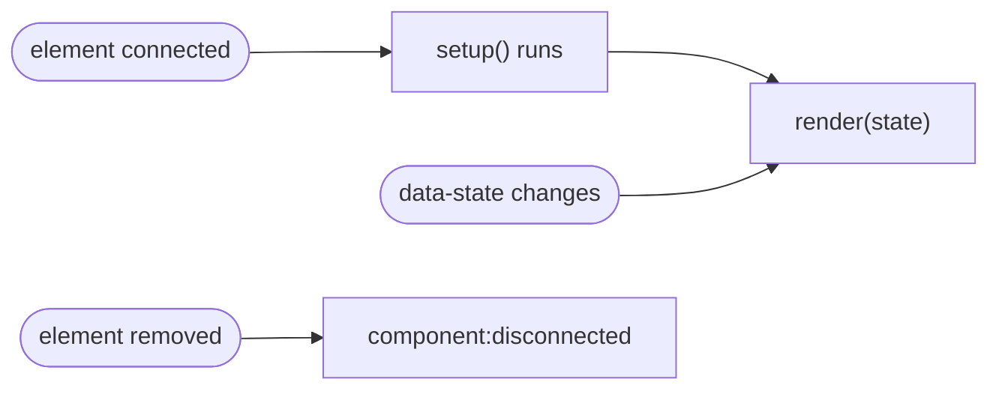

<div align="center">

# 🧩 web-components

**Write a `.sfc.html` file. Get a native custom element.**

Zero dependencies · No build step · Shadow DOM · One JSON attribute for state

[](https://www.npmjs.com/package/@vanillaspa/web-components)


[](https://unlicense.org)

[Quick start](#-quick-start) · [Components](#-writing-a-component) · [State](#-state--rendering) · [Loading](#-loading-components) · [API](#-api) · [Security](#-security--csp)

</div>

---

## ✨ See it in action

**`app-counter.sfc.html`**: one file, three optional sections

```html
<template>
    <button id="btn"><slot>Count</slot></button>
    <output id="out"></output>
</template>

<style>
    :host { display: inline-flex; gap: .5rem; align-items: center; }
    button { padding: .25rem .75rem; }
</style>

<script>
    const host = shadowDocument.host;
    const out = shadowDocument.getElementById('out');

    host.render = (state) => { out.textContent = state?.count ?? 0; };

    shadowDocument.getElementById('btn').addEventListener('click', () => {
        host.state = { count: (host.state?.count ?? 0) + 1 };
    });
</script>
```

**Use it anywhere in your HTML**

```html
<app-counter data-state='{"count":5}'>Click me</app-counter>
```

- 📄 **One file per component**: template, style and script together
- 🌑 **Native Shadow DOM**: real custom elements with scoped styles
- 🔁 **One JSON attribute**: `data-state` holds the state and drives `render()`
- 🪶 **Tiny**: no dependencies, no compiler, works with any bundler or none

---

## 🚀 Quick start

```bash
npm install @vanillaspa/web-components
```

```js
import { registerComponents } from '@vanillaspa/web-components';

await registerComponents(
    import.meta.glob('/src/components/**/*.sfc.html', { eager: true, query: '?raw' })
);
```

That's it: every `*.sfc.html` file is now a custom element. No Vite? See [Loading components](#-loading-components).

---

## 🧱 Writing a component

| Section      | What it does |
| ------------ | ------------ |
| `<template>` | Markup rendered into an open shadow root (`<slot>` works) |
| `<style>`    | Scoped CSS (`:host`, `::slotted`, …) |
| `<script>`   | Runs once per connect with `shadowDocument` (the shadow root) |

All three are optional. Only the **first** tag of each kind is used.

### The file name is the tag name

The part before the **first dot** becomes the tag. It must be lowercase and contain a hyphen. Folders don't matter.

| File                       | Result |
| -------------------------- | ------ |
| `src/components/app-card.sfc.html` | ✅ `<app-card>` |
| `modal.sfc.html`           | ❌ `name-derive-failed` (no hyphen) |

### The script

The script body becomes an **async function** inside an ES module:

```js
export async function setup(shadowDocument) { /* your script */ }
```

- `shadowDocument` is the `ShadowRoot`, and `shadowDocument.host` is the element itself.
- Top-level `await` works.
- `setup()` isn't awaited by the browser. If it rejects, the error is logged.
- It runs again on **every** connect, so release what you set up in [`component:disconnected`](#-cleanup).

> [!NOTE]
> Static `import` / `export` statements are **not** allowed inside the script. Use dynamic `import()` instead.
> Relative paths don't work (the module lives at a `blob:` URL). Use absolute URLs or bare specifiers resolved by an [import map](#using-libraries-inside-components).

---

## 🔄 State & rendering

`data-state` is the generic **component state**. Where you'd use `data-start="5"` for one value, `data-state` carries the whole state as one JSON value.

| Member               | Description |
| -------------------- | ----------- |
| `data-state="…"`     | Raw JSON attribute. It's **observed**: every change calls `render()`. |
| `host.state`         | Parsed attribute, a **fresh copy** on every read. `null` if absent or invalid JSON. |
| `host.state = value` | Writes `JSON.stringify(value)` to the attribute. `null`/`undefined` removes it. |
| `host.render(state)` | No-op by default. **Replace it in `setup()`** with your drawing function. |



`render(state)` is called **once after `setup()` resolved** and **whenever `data-state` changes while the element is connected**.

**Setting state**

```html
<upload-panel data-state='{"loading":true,"progress":40}'></upload-panel>
```

```js
const panel = document.querySelector('upload-panel');

panel.state = { loading: true, progress: 80 };    // preferred
panel.state = { ...panel.state, loading: false }; // update = assign a new object
panel.state = null;                               // removes the attribute
```

**Good to know**

- Write `state?.x ?? fallback`: `state` is `null` when the attribute is absent, removed **or** invalid JSON (invalid also logs an error).
- `host.state.x = 1` changes nothing, because it's a copy. Assign a new object.
- Setting the same JSON again, or changing it while the element is detached, doesn't call `render()`. On re-attach `setup()` runs and the initial render draws the latest state.
- Assign `host.render` in `setup()` **before any `await`**, so early state changes are drawn immediately.
- Writing `host.state` in `setup()` is fine. Don't write it unconditionally inside `render()`, that would loop.
- Errors thrown in `render()` are logged and never break the runtime.
- CSS can't look inside JSON. To style by state, toggle a class inside `render()`.
- `data-state` is the only observed attribute. Use a `MutationObserver` on the host for others.

---

## 📦 Loading components

`registerComponents()` takes `{ path: rawText }` where each value is the file content as a string, or a module whose `default` export is that string.

### Vite

```js
// eager, as strings
registerComponents(import.meta.glob('/src/components/**/*.sfc.html', { eager: true, query: '?raw', import: 'default' }));
```

<details>
<summary>Lazy (code-split) or a single file</summary>

```js
const lazy = import.meta.glob('/src/components/**/*.sfc.html', { query: '?raw', import: 'default' });
const raw = Object.fromEntries(
    await Promise.all(Object.entries(lazy).map(async ([path, load]) => [path, await load()]))
);
await registerComponents(raw);

// a single file
import card from './components/app-card.sfc.html?raw';
await registerComponents({ './components/app-card.sfc.html': card });
```
</details>

### No bundler: import map + `fetch`

```html
<script type="importmap">
{ "imports": { "@vanillaspa/web-components": "/node_modules/@vanillaspa/web-components/index.js" } }
</script>

<app-card data-state='{"title":"Hello"}'></app-card>

<script type="module">
    import { registerComponents } from '@vanillaspa/web-components';

    const files = ['./components/app-card.sfc.html', './components/nav-bar.sfc.html'];
    const entries = await Promise.all(files.map(async (path) => {
        const res = await fetch(path);
        if (!res.ok) throw new Error(`${path}: HTTP ${res.status}`);
        return [path, await res.text()];
    }));

    await registerComponents(Object.fromEntries(entries));
</script>
```

> [!TIP]
> Prefer a CDN? Point the import map to `https://cdn.jsdelivr.net/npm/@vanillaspa/web-components@<version>/index.js` and **pin an exact version**. The import map must come before the first module script.

### Using libraries inside components

Bare specifiers in dynamic `import()` are resolved by the page's import map, even from a component script:

```html
<script type="importmap">
{ "imports": { "dayjs": "https://cdn.jsdelivr.net/npm/dayjs@1.11.13/esm/index.js" } }
</script>
```

```html
<!-- app-clock.sfc.html -->
<template><time></time></template>
<script>
    const { default: dayjs } = await import('dayjs');
    const time = shadowDocument.querySelector('time');
    const tick = () => { time.textContent = dayjs().format('HH:mm:ss'); };

    tick();
    const id = setInterval(tick, 1000);
    shadowDocument.host.addEventListener('component:disconnected', () => clearInterval(id), { once: true });
</script>
```

<details>
<summary>Other bundlers, inline strings, file picker</summary>

**webpack**: treat the files as raw text

```js
// webpack.config.js
module.exports = { module: { rules: [{ test: /\.sfc\.html$/, type: 'asset/source' }] } };

// app
const ctx = require.context('./components', true, /\.sfc\.html$/);
registerComponents(Object.fromEntries(ctx.keys().map((key) => [key, ctx(key)])));
```

**esbuild**: `loader: { '.html': 'text' }`, then `import card from './app-card.sfc.html'`

**Inline strings** (demos, tests)

```js
await registerComponents({
    'hello-world.sfc.html': `<template><p>Hello <slot>world</slot>!</p></template>`
});
```

**File picker** (⚠️ executes the code in those files, see [Security](#-security--csp))

```js
input.addEventListener('change', async (e) => {
    const raw = {};
    for (const file of e.target.files) {
        if (file.name.endsWith('.sfc.html')) raw[file.name] = await file.text();
    }
    await registerComponents(raw);
});
```
</details>

---

## 🎨 Global styles

Pass any number of `CSSStyleSheet`s after the components. They're adopted by every shadow root **before** the component's own styles.

```js
import tailwindCss from '/src/styles/tailwind.css?inline';

const tailwind = new CSSStyleSheet();
tailwind.replaceSync(tailwindCss.replaceAll(':root', ':host')); // `:root` doesn't match inside a shadow root

await registerComponents(components, tailwind);
```

- `@import` rules are ignored in constructable stylesheets. Inline or concatenate your CSS first.
- A stylesheet imported in `main.js` (e.g. Font Awesome) only styles the **document**. To use its classes inside components, also pass it as a global sheet, and keep the document-level import so `@font-face` is registered.

---

## 🧹 Cleanup

`component:disconnected` is the **only event** the runtime dispatches. It fires on the host when the element is removed from the DOM (`bubbles: false`, so listen on the host itself).

Because `setup()` runs again on every connect, release timers, `window` listeners and observers here:

```js
const timer = setInterval(tick, 1000);
shadowDocument.host.addEventListener('component:disconnected', () => clearInterval(timer), { once: true });
```

`@vanillaspa/event-bus` builds on this event: listeners registered with the host element as `context` are removed automatically.

---

## 📖 API

### `registerComponents(rawComponents, ...globalStyles)`

```js
/**
 * @param {Record<string, string|{default: string}>} rawComponents  path → raw .sfc.html content
 * @param {...CSSStyleSheet} globalStyles                           optional, applied to every component
 * @returns {Promise<{ filePath: string, status: string, error?: Error|null }[]>}
 */
```

It **never rejects**. It resolves with one report per file, so check the statuses:

```js
const results = await registerComponents(components);

results
    .filter((r) => r.status !== 'ok' && r.status !== 'already-defined')
    .forEach((r) => console.error(`${r.filePath}: ${r.status}`, r.error));
```

| Status               | Meaning |
| -------------------- | ------- |
| `ok`                 | Registered. |
| `already-defined`    | A tag with that name was registered **before** this call. Nothing changed. |
| `name-derive-failed` | Path isn't a non-empty string, or the name has no hyphen. |
| `parse-failed`       | `DOMParser` returned no document. |
| `module-failed`      | The `<script>` couldn't be compiled or imported (syntax error, CSP, static `import`/`export`, …). |
| `style-failed`       | The constructable stylesheet failed (e.g. unsupported browser). |
| `define-failed`      | `customElements.define()` threw, e.g. invalid name or the **same name twice in one call**. |
| `system-error`       | Unexpected internal error (also logged). |

### Host element

| Member                   | Kind      | Description |
| ------------------------ | --------- | ----------- |
| `data-state`             | attribute | Observed JSON state |
| `state`                  | property  | Parsed `data-state` (copy, `null` if absent or invalid). Assigning writes it back. |
| `render(state)`          | method    | Replace in `setup()`. Called after `setup()` and on every state change while connected. |
| `component:disconnected` | event     | The only event. Fired when the element is removed. |
| `shadowRoot`             | property  | Open shadow root (also passed to `setup()`) |

Types (JSDoc): `SFCContent`, `RegistrationResult`.

---

## 🔒 Security & CSP

Component scripts run through a temporary **Blob URL** (`import(blobUrl)`, revoked after loading). No `eval` or `new Function`, so `unsafe-eval` and Trusted Types are **not** needed, but your CSP must allow `blob:`:

```
Content-Security-Policy: script-src 'self' blob:; script-src-elem 'self' blob:
```

> [!WARNING]
> Component scripts run with the **full privileges of your page**. `shadowDocument` is a convenience, not a sandbox. Only register components from sources you trust. Loading `.sfc.html` from user input or third-party servers means executing that code.

Vite's `server.headers` only applies to the **dev server**. Set the same headers in production (proxy, CDN or hosting config).

---

## 🛠 Vite project setup

<details>
<summary><b>vite.config.js</b>: the parts that matter</summary>

```js
import { defineConfig } from 'vite';
import tailwindcss from '@tailwindcss/vite';

export default defineConfig({
    build: { target: 'esnext' },               // top-level await in main.js
    server: {
        headers: {
            // `blob:` is required by this package. 'wasm-unsafe-eval' is only for SQLite WASM.
            'Content-Security-Policy':
                "default-src 'self'; script-src 'self' 'wasm-unsafe-eval' blob:; script-src-elem 'self' blob:; " +
                "img-src 'self' data:; style-src 'self' 'unsafe-inline'; connect-src 'self' ws: wss:;",
            'Cross-Origin-Embedder-Policy': 'require-corp',  // SQLite WASM (OPFS) only
            'Cross-Origin-Opener-Policy': 'same-origin',     // SQLite WASM (OPFS) only
            'X-Content-Type-Options': 'nosniff',
            'X-Frame-Options': 'DENY'
        }
    },
    optimizeDeps: { exclude: ['@sqlite.org/sqlite-wasm'] },  // only if you use SQLite WASM
    plugins: [tailwindcss()]
});
```
</details>

<details>
<summary><b>src/main.js</b>: boot sequence</summary>

```js
import { registerComponents } from '@vanillaspa/web-components';
import tailwindCss from '/src/styles/tailwind.css?inline';

const tailwind = new CSSStyleSheet();
tailwind.replaceSync(tailwindCss.replaceAll(':root', ':host'));

// 1. register components and report failures
const components = import.meta.glob('/src/components/**/*.sfc.html', { eager: true, query: '?raw' });
const results = await registerComponents(components, tailwind);
results
    .filter((r) => r.status !== 'ok' && r.status !== 'already-defined')
    .forEach((r) => console.error(`${r.filePath}: ${r.status}`, r.error));

const root = 'home-page';
if (!customElements.get(root)) throw new Error(`<${root}> was not registered, see errors above.`);

// 2. optional runtime modules, exposed on `window` (one failing module doesn't block the boot)
const modules = [
    { load: () => import('@vanillaspa/sqlite-database') },
    // { load: () => import('@vanillaspa/event-bus') }   // → window.eventbus
];
const loaded = await Promise.allSettled(modules.map((m) => m.load()));
loaded.forEach((result, i) => {
    if (result.status === 'rejected') return console.error(`Module ${i} failed:`, result.reason);
    const name = modules[i].name || result.value.name;
    if (name) window[name] = Object.freeze({ ...result.value });
});

// 3. mount last, so components can rely on those globals in setup()
document.body.replaceChildren(document.createElement(root));
```
</details>

---

## ⚠️ Limitations

- Only the first `<template>`, `<style>` and `<script>` of a file are used.
- Tag names come from `/`-separated paths. Normalize Windows backslashes first.
- Components are registered once. There's no hot replacement (`already-defined`).
- No server-side rendering and no template binding: drawing state is up to your `render()`.

## 🌍 Browser support

Current evergreen browsers (roughly Chrome/Edge 89+, Firefox 108+, Safari 16.4+): custom elements, Shadow DOM, constructable stylesheets, dynamic `import()` and Blob URLs.

## 📄 License

[Unlicense](https://unlicense.org): public domain.